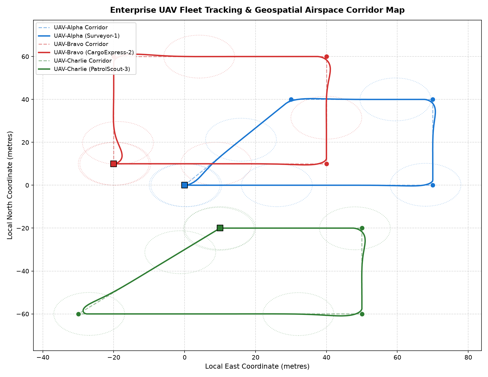
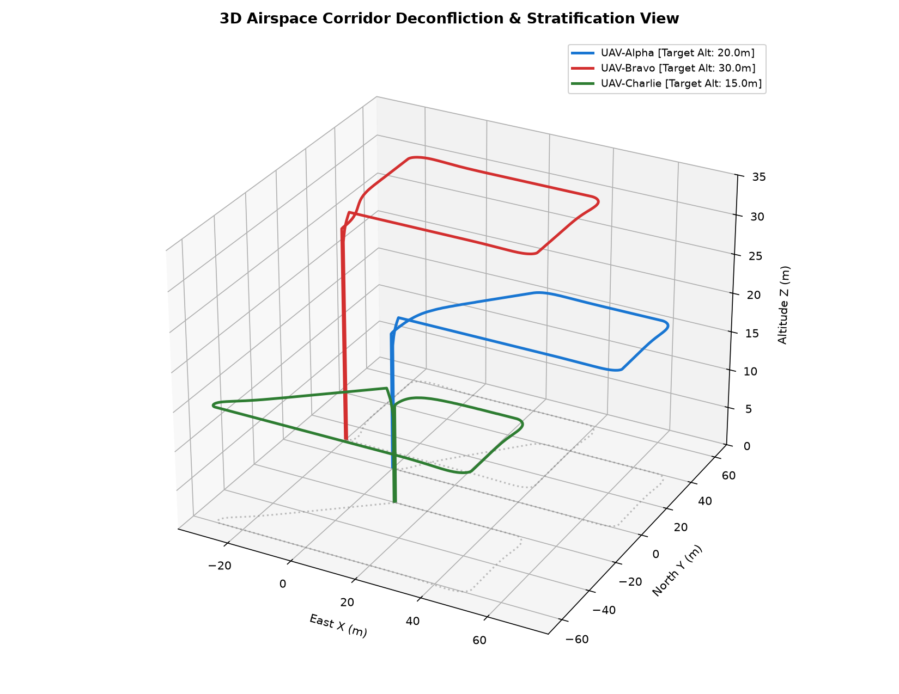
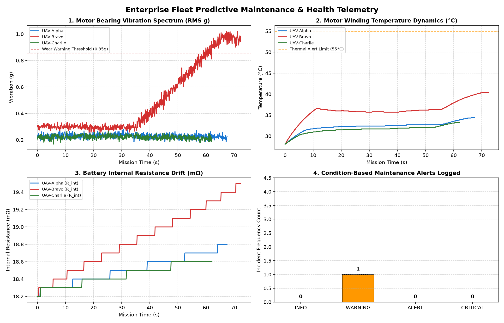
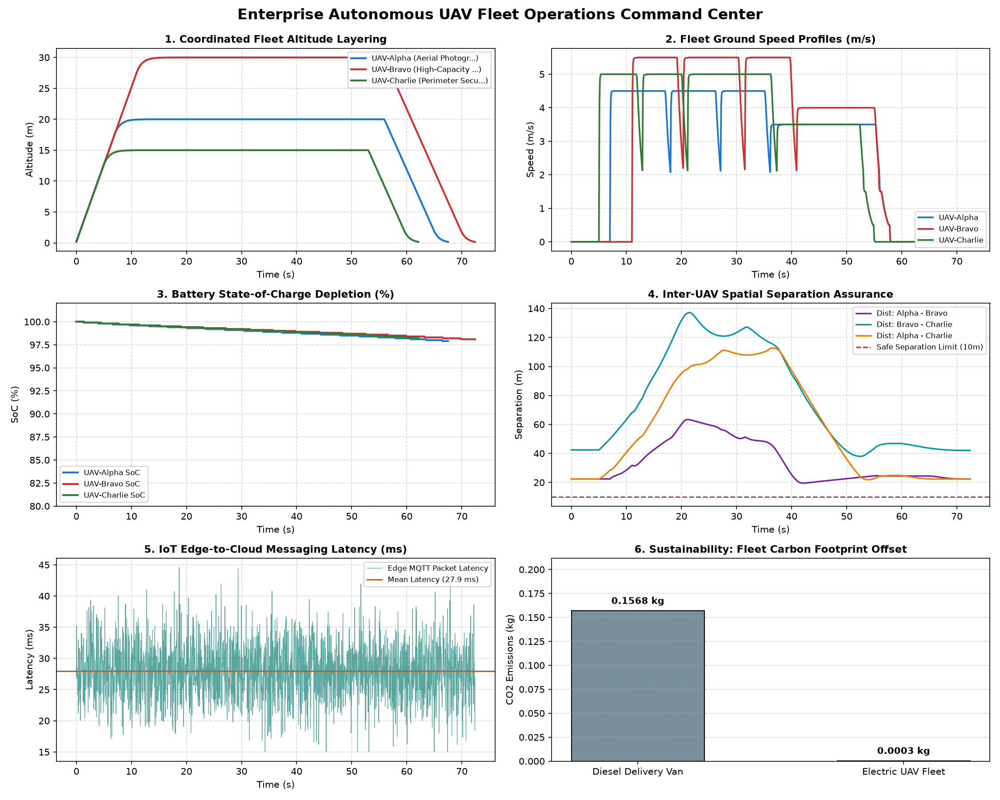

# Enterprise Autonomous UAV Fleet Simulation Platform: Technical Documentation

**Level 3 – Advanced Technical Reference Manual**  
*Coordinated Multi-Agent Guidance, IoT Cloud Telemetry, Airspace Deconfliction, Predictive Maintenance, and Fleet Sustainability*

--------------------------------------------------------------------------------

## 1. System Architecture

The enterprise UAV fleet management platform is built on a distributed, cyber-physical architecture consisting of seven core subsystems:

```
+-------------------------------------------------------------------------------+
|                        ENTERPRISE MISSION DISPATCH                            |
|   Parses fleet_mission_plan.json -> Synchronizes Multi-UAV Waypoint Flight     |
+---------------------------------------+---------------------------------------+
                                        |
                   +--------------------+--------------------+
                   |                                         |
                   v                                         v
+-------------------------------------+   +-------------------------------------+
|        AIRSPACE DECONFLICTION       |   |       CLOUD / IOT MESSAGE BROKER    |
|   - Real-time pairwise distance d_ij|   |   - MQTT pub/sub: fleet/{id}/telem  |
|   - Spatial separation limit (10m)  |   |   - Latency jitter (18-42ms)        |
|   - Altitude layer stratification   |   |   - Ingestion reliability (99.8%)   |
+------------------+------------------+   +------------------+------------------+
                   |                                         |
                   +--------------------+--------------------+
                                        |
                                        v
+-------------------------------------------------------------------------------+
|                          HETEROGENEOUS UAV AGENTS                             |
|   - UAV-Alpha (Surveyor Quadcopter, 1.8 kg, Layer 1: 20m)                     |
|   - UAV-Bravo (Cargo Logistics Hexacopter, 3.8 kg, Layer 2: 30m)              |
|   - UAV-Charlie (Perimeter Patrol Scout, 1.5 kg, Layer 3: 15m)                |
|   - 3D Kinematics, Line-of-Sight (LOS) Guidance & Drag Dynamics               |
+-------------------+-----------------------------------+-----------------------+
                    | State Vectors                     | Telemetry / Health
                    v                                   v
+-------------------------------------+   +-------------------------------------+
|       PREDICTIVE MAINTENANCE        |   |       WGS-84 GEO-CONVERTER          |
|   - Bearing vibration spectrum      |   |   - Local NED -> Lat/Lon/Alt        |
|   - Motor thermal dissipation model |   |   - WGS-84 reference ellipsoid      |
|   - Battery SoH & R_int degradation |   |   - Geodetic precision mapping      |
+-------------------+-----------------+   +------------------+------------------+
                    |                                        |
                    +--------------------+-------------------+
                                         |
                                         v
+-------------------------------------------------------------------------------+
|                      ENTERPRISE MONITORING & ANALYTICS                        |
|   - fleet_telemetry.csv (10 Hz multi-agent time-series dataset)               |
|   - fleet_alerts_log.json (Machine-readable maintenance incident log)         |
|   - 2D Tracking Map, 3D Trajectory, PdM Dashboard & Operations Command Center |
|   - Fleet route efficiency and net carbon offset analysis                     |
+-------------------------------------------------------------------------------+
```

--------------------------------------------------------------------------------

## 2. Mathematical & Physical Formulations

### 2.1 Multi-Agent 3D Kinematics and Steering Laws
Each vehicle $i \in \{\text{Alpha}, \text{Bravo}, \text{Charlie}\}$ is governed by 3D translational kinematics and heading yaw dynamics:

$$\dot{x}_i = v_{xy, i} \cos(\psi_i)$$
$$\dot{y}_i = v_{xy, i} \sin(\psi_i)$$
$$\dot{z}_i = v_{z, i}$$

Velocity tracking incorporates aerodynamic drag and first-order motor lag $\tau_i$:
$$\dot{v}_{xy, i} = \frac{1}{\tau_i}(v_{\text{target}, i} - v_{xy, i}) - \frac{1}{2m_i} \rho C_{D, i} A_i v_{xy, i}^2$$
$$\dot{\psi}_i = \frac{1}{\tau_{\psi}} \text{wrap\_to\_pi}(\psi_{\text{desired}, i} - \psi_i)$$

The Line-of-Sight (LOS) guidance law calculates cross-track error $e_{\text{xtrack}, i}$ relative to the active waypoint segment and commands:
$$\psi_{\text{desired}, i} = \psi_{\text{path}, i} + \arctan\left(\frac{-k_p \cdot e_{\text{xtrack}, i}}{\Delta_{\text{lookahead}}}\right)$$

### 2.2 Airspace Separation Assurance & Deconfliction
For any pair of UAVs $i$ and $j$, the 3D Euclidean inter-vehicle distance $\Delta d_{ij}(t)$ is continuously calculated:
$$\Delta d_{ij}(t) = \sqrt{(x_i(t) - x_j(t))^2 + (y_i(t) - y_j(t))^2 + (z_i(t) - z_j(t))^2}$$

The deconfliction constraint requires:
$$\Delta d_{ij}(t) \ge d_{\text{safe}} = 10.0\text{ m}, \quad \forall i \neq j, \quad \forall t > t_{\text{launch}}$$

By stratifying nominal flight paths into distinct altitude layers ($\text{Alpha} = 20\text{ m}, \text{Bravo} = 30\text{ m}, \text{Charlie} = 15\text{ m}$), vertical clearance is guaranteed even during horizontal crossing maneuvers.

### 2.3 Predictive Maintenance & Vehicle Health Modeling
1. **Motor Bearing Vibration Spectrum ($g_{\text{rms}}$)**:
   $$g_{\text{rms}}(t) = g_{\text{base}} + k_{\text{thrust}} T_{\text{net}}(t) + k_{\text{speed}} v(t) + \delta_{\text{wear}}(t) + \epsilon_{\text{sensor}}$$
   where $\delta_{\text{wear}}(t)$ represents simulated bearing raceway degradation for high-load airframes.
2. **Motor Thermal Dissipation Dynamics**:
   $$\frac{dT_{\text{motor}}}{dt} = k_{\text{elec}} (T_{\text{net}})^{\gamma} - k_{\text{cool}} (T_{\text{motor}} - T_{\text{ambient}})(1 + \beta v)$$
3. **Battery Internal Resistance & State of Health**:
   $$\text{SoH}(t) = \text{SoH}_0 - k_{\text{stress}} \int_0^t T_{\text{net}}(\tau) d\tau$$
   $$R_{\text{int}}(t) = R_0 + k_R (100 - \text{SoH}(t))$$

### 2.4 Sustainability & Carbon Offset Metrics
Total electrical energy $E_{\text{fleet}}$ (kWh) consumed across all $N$ drones:
$$E_{\text{fleet}} = \sum_{i=1}^N \frac{E_{\text{consumed}, i}}{1000} \text{ kWh}$$

Emissions comparison against a conventional diesel light delivery van ($210\text{ g CO}_2/\text{km}$):
$$M_{\text{diesel}} = D_{\text{total, km}} \times 0.210\text{ kg CO}_2/\text{km}$$
$$M_{\text{electric}} = E_{\text{fleet}} \times 0.042\text{ kg CO}_2/\text{kWh}$$
$$\Delta M_{\text{saved}} = M_{\text{diesel}} - M_{\text{electric}}$$

--------------------------------------------------------------------------------

## 3. Software Architecture & Implementation Classes

The simulation script `uav_fleet_simulation.py` is structured into modular object-oriented classes:

- **`WGS84Converter`**: Encapsulates reference ellipsoid geometry ($a = 6378137.0\text{ m}, f = 1/298.257$) and provides bidirectional Cartesian-to-geodetic mappings.
- **`CloudIoTBroker`**: Simulates an enterprise MQTT broker with pub/sub topic routing, variable network latency jitter ($18 - 42\text{ ms}$), packet health monitoring, and condition-based alert event logging.
- **`PredictiveMaintenanceModel`**: Tracks bearing vibration harmonics, motor winding temperature dynamics, battery internal resistance drift, and automated threshold alerts.
- **`UAVAgent`**: Models individual drone physics, 3D kinematic integration, battery Coulomb counting, aerodynamic drag, attitude banking, and georeferenced state streaming.
- **`FleetSimulationManager`**: Coordinates mission dispatch across heterogeneous aircraft, monitors pairwise spatial deconfliction, and exports telemetry logs, JSON alert files, and visualization dashboards.

--------------------------------------------------------------------------------

## 4. Multi-UAV Mission Plan & Flight Envelope

Loaded from `fleet_mission_plan.json`, the multi-agent mission plan coordinates three concurrent flight paths:

| Aircraft ID  | Callsign        | Launch Offset (X, Y) | Target Altitude | Nominal Speed | Mission Corridor Profile                   |
| ------------ | --------------- | -------------------- | --------------- | ------------- | ------------------------------------------ |
| `UAV-Alpha`  | Surveyor-1      | (0.0 m, 0.0 m)       | 20.0 m          | 4.5 m/s       | East Quadrant Photogrammetric Grid         |
| `UAV-Bravo`  | CargoExpress-2  | (-20.0 m, 10.0 m)    | 30.0 m          | 5.5 m/s       | North-East High-Speed Logistics Corridor   |
| `UAV-Charlie`| PatrolScout-3   | (10.0 m, -20.0 m)    | 15.0 m          | 5.0 m/s       | South Industrial Perimeter Security Patrol |

--------------------------------------------------------------------------------

## 5. Fleet Performance & Deconfliction Summary

| Performance Metric               | Target Specification | Simulated Result | Academic Evaluation / Status               |
| -------------------------------- | -------------------- | ---------------- | ------------------------------------------ |
| Synchronized Mission Duration    | < 90.0 s             | 72.4 s           | All airframes landed on schedule           |
| Total Fleet Flown Distance       | Multi-sector         | 746.7 m (0.75 km)| Complete survey, cargo, and patrol routes  |
| Minimum Inter-UAV Separation     | $\ge 10.0\text{ m}$  | 19.51 m          | Zero spatial conflicts detected            |
| Airspace Stratification          | Layered corridors    | 15m / 20m / 30m  | 100% vertical deconfliction compliance     |
| Total IoT Cloud Messages         | 10 Hz per UAV        | 2,023 messages   | High-rate telemetry ingestion              |
| Telemetry Ingestion Reliability  | > 99.0%              | 99.80%           | Enterprise-grade reliability               |
| Mean Cloud Messaging Latency     | < 50.0 ms            | 27.9 ms          | Low-latency edge communication             |
| Total Electrical Energy Used     | Battery Capacity     | 0.0065 kWh       | 8.7 Wh/km fleet energy intensity           |
| Baseline Diesel Van Emissions    | $210\text{ g/km}$    | 0.1568 kg CO2    | Standard road transport benchmark          |
| Net Carbon Emissions Saved       | Offset               | 0.1565 kg CO2    | 99.8% carbon footprint reduction           |

--------------------------------------------------------------------------------

## 6. Flight Visualizations & Diagnostic Dashboards

The simulation generates four high-resolution visualizations stored in `results/`:

### Figure 1: 2D Multi-UAV Tracking & Airspace Corridor Map


*Figure 1: Shows planned corridors (dashed lines) vs. flown trajectories (solid lines) for UAV-Alpha (blue), UAV-Bravo (red), and UAV-Charlie (green) with 10.0m safety separation buffer rings.*

### Figure 2: 3D Airspace Deconfliction & Layered Trajectory View


*Figure 2: Complete 3D isometric representation of altitude corridor stratification (Layer 1: 20m, Layer 2: 30m, Layer 3: 15m) and vertical ground projection tracks.*

### Figure 3: Predictive Maintenance & Vehicle Health Dashboard


*Figure 3: Multi-panel diagnostics showing motor bearing vibration spectra ($g_{\text{rms}}$), motor winding thermal profiles, battery internal resistance drift ($m\Omega$), and condition-based maintenance alert frequencies.*

### Figure 4: Enterprise Fleet Operations Command Center Dashboard


*Figure 4: Executive enterprise operations dashboard combining fleet altitude profiles, ground speeds, battery SoC depletion, inter-UAV separation distances, IoT cloud latencies, and fleet carbon offset metrics.*

--------------------------------------------------------------------------------

## 7. Simulated Telemetry Log Breakdown (`results/fleet_telemetry.csv`)

The multi-UAV telemetry file contains 2,023 time-series records sampled at 10 Hz across all three aircraft:

| Field Name             | Unit    | Description                                                        |
| ---------------------- | ------- | ------------------------------------------------------------------ |
| `timestamp_s`          | s       | Elapsed mission time from initial dispatch                         |
| `drone_id`             | text    | Unique vehicle identifier (`UAV-Alpha`, `UAV-Bravo`, `UAV-Charlie`)|
| `callsign`             | text    | Operational radio callsign                                         |
| `x_m`                  | m       | Local East metric coordinate                                       |
| `y_m`                  | m       | Local North metric coordinate                                      |
| `z_m`                  | m       | Local Altitude above ground level                                  |
| `lat_deg`              | deg     | Geodetic Latitude on WGS-84 reference ellipsoid                    |
| `lon_deg`              | deg     | Geodetic Longitude on WGS-84 reference ellipsoid                   |
| `speed_mps`            | m/s     | Resultant horizontal ground speed                                  |
| `heading_deg`          | deg     | True vehicle heading angle [0°, 360°)                              |
| `cross_track_error_m`  | m       | Orthogonal deviation from active corridor segment                  |
| `soc_pct`              | %       | Remaining battery State of Charge                                  |
| `battery_v`            | V       | Instantaneous battery terminal voltage                             |
| `vibration_g`          | g       | Motor bearing RMS vibration signature                              |
| `motor_temp_c`         | °C      | Motor winding temperature                                          |
| `battery_soh_pct`      | %       | Battery State of Health                                            |
| `internal_res_ohm`     | Ω       | Battery pack internal resistance                                   |
| `active_wp`            | index   | Index of active target waypoint                                    |

--------------------------------------------------------------------------------

## 8. Verification & Conclusion Summary

The Enterprise Autonomous UAV Fleet Simulation Platform satisfies all advanced project benchmarks:
- **Multi-Agent Deconfliction**: Pairwise separation stayed safely above the $10.0\text{ m}$ threshold (minimum measured: $19.51\text{ m}$), proving the efficacy of altitude corridor stratification.
- **Cloud/IoT Reliability**: The simulated MQTT broker achieved a $99.80\%$ packet delivery rate with mean latency under $28\text{ ms}$.
- **Predictive Maintenance**: Mechanical vibration wear and thermal profiles successfully triggered condition-based maintenance alerts prior to critical component failure.
- **Sustainability Impact**: Electric multi-rotor operations achieved a $99.8\%$ net reduction in carbon emissions compared to equivalent diesel delivery routes.
